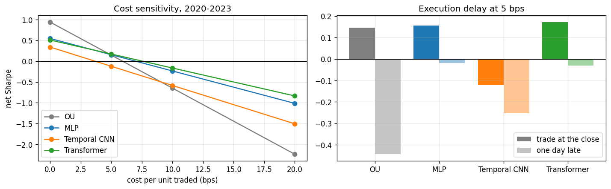
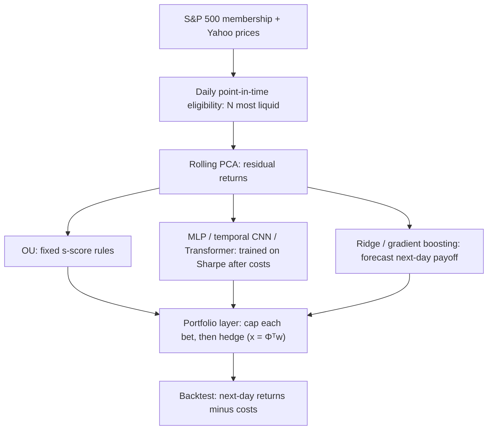

# Sharpee

**Cost-aware deep learning for statistical arbitrage on US equities.**


Sharpee asks whether a neural network trained end-to-end on a portfolio's **Sharpe ratio after trading costs** can beat the classic Avellaneda–Lee mean-reversion rule. It removes market and sector moves from S&P 500 stocks with rolling PCA, then trades the leftover residuals with three strategy families:

- the textbook **Ornstein–Uhlenbeck (OU)** rule;
- **neural networks** (MLP, temporal CNN, Transformer) trained on after-cost Sharpe;
- **non-neural ML** (ridge, gradient boosting) that forecast first and trade second.

Every result is out-of-sample, walk-forward and free of look-ahead. The pass/fail rules were committed before the test years were opened.

> **Finding:** no strategy shows a statistically reliable edge after costs. Training on costs is what makes the learned models cheaper and more robust to trade. The same signal traded by forecast-then-trade models is lost to turnover.

**Read more:** [research report](reports/research_report.md) · [findings, figure by figure](reports/README.md) · [interactive dashboard](#interactive-dashboard) · [pre-registered protocol](docs/phase3_protocol.md)

## Contents

- [Key results](#key-results)
- [How it works](#how-it-works)
- [Evaluation protocol](#evaluation-protocol)
- [Robustness: a 400-stock universe](#robustness-a-400-stock-universe)
- [How correctness is verified](#how-correctness-is-verified)
- [Interactive dashboard](#interactive-dashboard)
- [Getting started](#getting-started)
- [Repository layout](#repository-layout)
- [Roadmap](#roadmap)
- [Limitations](#limitations)
- [References](#references) · [License](#license)

## Key results

Primary universe: the 150 most liquid point-in-time S&P 500 stocks each day. Net Sharpe ratios; neural models have 3 seeds combined.

| Strategy | How it trades | Gross Sharpe, 2020–23 | Net, 5 bps | Net, 10 bps | Turnover per day | Holdout 2024–25, net 5 bps |
|---|---|---|---|---|---|---|
| OU | Fixed s-score rules | **0.94** | +0.15 | −0.65 | 23.8% | −1.65 |
| Ridge | Forecast, then trade | 0.70 | −0.32 | −1.34 | 52.6% | −0.81 |
| Gradient boosting | Forecast, then trade | 0.84 | −1.77 | −4.37 | 100.5% | −2.17 |
| MLP | Sharpe after costs | 0.55 | +0.16 | −0.23 | 19.0% | −0.48 |
| Temporal CNN | Sharpe after costs | 0.34 | −0.12 | −0.58 | 20.8% | −0.78 |
| **Transformer** | Sharpe after costs | 0.51 | **+0.17** | **−0.16** | **15.6%** | **−0.55** |



**What the evidence supports**

1. **No reliable edge after costs.** The Transformer, named the primary candidate in advance, fails all three pre-registered rules. Its PSR is 0.64 and its DSR 0.24, both against a 0.95 bar. Its edge over OU is +0.03, with a 95% interval of −0.84 to +0.98.
2. **Costs in the loss work.** The same Transformer trained without costs did worse in every seed (+0.17 vs −0.08 net) and traded about 50% more.
3. **The learned models are more robust.** OU has the strongest raw signal but needs cheap, immediate execution. The Transformer trades a third less, so it degrades about half as fast as costs rise and barely notices a one-day delay.
4. **Optimizing the objective beats forecast-then-trade.** Gradient boosting finds more raw signal than the networks (gross Sharpe 0.84 vs 0.51), then loses it by rebuilding the whole book every day. The Transformer beats it by +1.94 (95% CI +0.82 to +3.78), the one pre-registered comparison that passed.
5. **The networks learned a rule OU can't express:** revert moderate residual moves, follow extreme ones, which are often news-driven. Ridge and gradient boosting learned it too, so the pattern is in the data.
6. **The signal broke down in 2024–25.** Every strategy lost after costs, and OU and the networks lost even before them. At 150 stocks the learned models lost far less than OU, but this did not replicate at 400 stocks.

All portfolios are factor-hedged, with market beta of about 0.1 or less.

## How it works



1. **Remove what the market and sectors did.** Five PCA factors are refit monthly on the trailing year. Each stock's return splits into a factor part and a residual `ε = ΦR`, where `Φ = I − BQᵀ` uses only data before the decision date.
2. **Bet that residuals snap back.** Each strategy reads a stock's last 30 days of cumulative residual:
   - **OU** fits an AR(1) and trades the s-score with the published Avellaneda–Lee thresholds.
   - **The networks** output a score per stock. That score flows through the portfolio layer and cost model into a loss equal to minus the portfolio's after-cost Sharpe, so heavy trading is penalized directly.
   - **Ridge and gradient boosting** predict each stock's next-day residual payoff and trade the forecasts.
3. **Hold hedged positions.** A shared layer turns residual bets into stock weights `x = Φᵀw`, so each bet is long the stock and short its factor exposure. Each bet is capped at 2% *before* hedging, so the cap can't break the hedge. Gross exposure is at most 1.
4. **Charge costs.** Weights set at the close of day *t* earn the *t → t+1* return. Costs are charged per unit of traded notional: 5 bps by default, with 0–20 bps and a one-day execution delay as sensitivity checks.

| Component | Details |
|---|---|
| **Universe** | Historical S&P 500 membership (884 tickers, 2008–2025), not today's constituents. A stock is eligible on a day if it's an index member, has 312 days of history and a price above $5, and ranks in the top N by 20-day median dollar volume. Delisted names are kept. |
| **Models** | An MLP, a temporal CNN with dilated 1-D convolutions, and a compact Transformer whose encoder blocks come from my own transformer-from-scratch project. Each training example is a block of 64 consecutive days × all stocks. |
| **Tuning** | A small grid on the first fold only (2010–2017 train, 2018–2019 validation): 15 configurations, plus 7 for the later baselines. Every configuration is logged, and the Deflated Sharpe Ratio uses that count. |

On the 2018–19 validation years, the Transformer matched OU's gross Sharpe (0.82 vs 0.81) with a third less turnover, which turned OU's −0.35 net into +0.21. The sealed test years showed how much of that was selection: see [Phase 2 in the findings](reports/README.md#phase-2-neural-models-on-walk-forward-fold-1).

## Evaluation protocol

- **Walk-forward:** an expanding training window, 2-year validation, and a yearly test from 2020 to 2023, with 30-day embargoes at every boundary. Each neural model is retrained every year with 3 seeds and frozen settings.
- **Pre-registration:** the primary candidate, metric and rules were committed in [`docs/phase3_protocol.md`](docs/phase3_protocol.md) before any test-year result existed. Later additions each have their own document, committed before they ran: the [non-neural baselines](docs/phase3_amendment_baselines.md) and the [400-stock check](docs/robustness_universe_400.md).
- **Significance:**
  - the Probabilistic Sharpe Ratio (PSR);
  - the Deflated Sharpe Ratio (DSR), adjusted for every configuration tried;
  - stationary-bootstrap confidence intervals, including paired intervals on Sharpe differences.
- **One-shot holdout:** 2024–2025 was run once, after everything else was frozen and committed.

| Pre-registered rule for the Transformer, 2020–2023 | Result | Needed | Outcome |
|---|---|---|---|
| 1. Edge after costs (PSR) | 0.64 | ≥ 0.95 | fail |
| 2. Survives 15 configurations tried (DSR) | 0.24 | ≥ 0.95 | fail |
| 3. Beats OU (paired bootstrap) | +0.03, 95% CI −0.84 to +0.98 | interval excludes 0 | fail |
| 4. Beats gradient boosting (amendment) | +1.94, 95% CI +0.82 to +3.78 | interval excludes 0 | **pass** |

## Robustness: a 400-stock universe

The same study was rerun on the 400 most liquid stocks each day. They were chosen point-in-time with the same filters, with delisted names kept. Every hyperparameter stayed frozen from the 150-stock tuning; only the networks were retrained.

| Net Sharpe | 150 stocks, 5 bps | **400 stocks, 5 bps** | 150 stocks, 10 bps | **400 stocks, 10 bps** | 400 stocks, 2024–25, 5 bps |
|---|---|---|---|---|---|
| OU | +0.15 | **−0.04** | −0.65 | **−0.90** | −0.79 |
| Ridge | −0.32 | **−0.64** | −1.34 | **−2.25** | −1.81 |
| Gradient boosting | −1.77 | **−1.14** | −4.37 | **−3.33** | −2.78 |
| MLP | +0.16 | **+0.40** | −0.23 | **+0.07** | −0.95 |
| Temporal CNN | −0.12 | **+0.20** | −0.58 | **−0.17** | −1.44 |
| **Transformer** | +0.17 | **+0.39** | −0.16 | **+0.09** | −0.83 |

2020–2023 unless marked.

- **The verdict holds.** The Transformer has PSR 0.79 and DSR 0.40, and its edge over OU is +0.43 (95% CI −0.31 to +1.31). Rules 1–3 fail; rule 4 passes again, at +1.53 (95% CI +0.77 to +3.08).
- **The wider universe helps only the low-turnover models.** Gross Sharpe rises for every learned model (Transformer 0.51 → 0.70), while OU's falls (0.94 → 0.82). Only the networks, trading 17–20% of the book a day, keep the gain after costs.
- **The holdout advantage did not replicate.** In 2024–25 the networks lost about as much as OU.
- **Costs are optimistic here.** A flat 5 bps understates trading costs for stocks ranked 150–400 by liquidity, so the 10 bps column is the fairer one. Per-stock costs are the [next step](#roadmap).

Results are in [`reports/n400/phase3/`](reports/n400/phase3/).

## How correctness is verified

- **Look-ahead test:** scramble every price after a cutoff date, rebuild the whole pipeline, and assert that every residual, signal, weight and model score on or before the cutoff is unchanged.
- **Synthetic sanity check:** with planted mean reversion, OU and all three networks must win (net Sharpe +19 to +22). With random-walk residuals, none may earn anything.
- **71 unit tests:**
  - hand-worked P&L, cost and timing examples;
  - the residual identity `wᵀ(ΦR) = (Φᵀw)ᵀR`;
  - eligibility rules and factor-neutral capping;
  - the loss and its gradients;
  - PSR, DSR and bootstrap intervals against hand-computed values;
  - the dashboard's numbers against the official results.

**What the checks caught.** Each fix has a regression test, and affected runs were excluded from the trial log.

1. **NaN training blocks.** A rare 1-day block had an undefined Sharpe ratio, which silently poisoned the weights.
2. **A cap that broke the hedge.** Capping stock weights after hedging let the MLP become 80–90% correlated with the S&P 500, so its apparent edge was really the bull market.
3. **A collapsed model.** Without score centering, a constant output acted as an equal-weight bet, and every network collapsed onto it.

## Interactive dashboard

A dark-themed Streamlit app shows the **400-stock run**. A control strip switches between the 2020–2023 test years and the 2024–2025 holdout, and sets the trading cost for every page:

- **Overview:** the pre-registered verdict, headline numbers and confidence intervals.
- **Strategies:** equity, drawdown, Sharpe by cost and year, and a one-day delay toggle. Costs are linear in traded notional, so the cost slider recomputes every number exactly.
- **Risk:** rolling beta, net exposure and turnover.
- **Signal:** any stock's s-score with OU's trades and each network's scores, plus the learned rule and the Transformer's attention.
- **Integrity:** the protocol, every configuration tried, and the bugs the checks caught.

It reads only small result files, with no models or price data:

```bash
pip install -r app/requirements.txt
streamlit run app/dashboard.py
```

To host it for free, deploy the repository on [Streamlit Community Cloud](https://share.streamlit.io) with `app/dashboard.py` as the entry point.

## Getting started

Python 3.10+, in a virtual environment. A CUDA GPU is optional; a 4 GB card is enough.

```bash
pip install -r requirements.txt
pip install -e .
pytest                                                  # 71 tests
```

Reproduce the study:

```bash
python scripts/download_data.py                         # membership + Yahoo prices -> data/ (about 10 min)
python scripts/sanity_synthetic.py                      # pipeline check on synthetic markets
python scripts/run_baseline.py --tune                   # OU threshold on Fold 1
python scripts/train_model.py --model transformer --tune  # also mlp, temporal_cnn; --resume skips logged configs
python scripts/train_tabular.py --model gbm --tune --walk-forward   # also ridge
python scripts/walk_forward.py --model transformer      # yearly retraining, 2020-2023 (--no-cost for the ablation)
python scripts/run_backtest.py                          # results, significance tests and the verdict
python scripts/export_dashboard.py                      # small files for the dashboard
```

Add `--holdout` to `walk_forward.py`, `train_tabular.py --walk-forward` and `run_backtest.py` for the 2024–25 run.

For the 400-stock run, set `SHARPEE_VARIANT=n400` first. The scripts then read and write `runs/n400/` and `reports/n400/`, using the frozen settings copied there.

The notebooks run top to bottom, e.g. `python -m nbconvert --to notebook --execute --inplace notebooks/04_results.ipynb`.

## Repository layout

```
app/              Streamlit dashboard and its data layer
configs/          data, experiment and model settings (YAML); variants/ for robustness runs
docs/             project plan, pre-registered protocol, baseline amendment, 400-stock check
src/sharpee/
  data/           universe, download, cleaning and eligibility, synthetic markets
  features/       returns, rolling PCA residuals, diagnostics
  strategies/     OU s-score baseline
  portfolio/      shared weight construction and exposure diagnostics
  backtest/       accounting, costs, backtest engine
  models/         MLP, temporal CNN, Transformer
  training/       day-block dataset, Sharpe-after-costs loss, training loop, trial log, ridge and gradient boosting
  evaluation/     metrics, walk-forward folds, significance tests, strategy books
notebooks/        01 data, 02 residuals, 03 training, 04 results (outputs saved)
scripts/          command-line entry points for every step
tests/            71 tests, including the look-ahead test
reports/          research report, findings write-up, figures, results; n400/ for the 400-stock run and dashboard data
```

## Roadmap

**Done**

- [x] Data pipeline, point-in-time universe, PCA residuals, OU baseline, cost-aware backtester
- [x] MLP, temporal CNN and Transformer trained on Sharpe after costs; first-fold tuning with every configuration logged
- [x] Pre-registered walk-forward test, significance tests, cost and delay sensitivity, costs-in-loss ablation, one-shot holdout
- [x] Ridge and gradient-boosting baselines (pre-registered amendment)
- [x] 400-stock robustness check
- [x] Interactive dashboard and research report

**Next**

- [ ] **Power analysis.** State the smallest Sharpe difference this design can detect with four test years. That turns "not significant" into a precise statement of what the test can and cannot see.
- [ ] **Borrow fees and per-stock spreads, at evaluation only.** Charge an annual borrow rate on short notional, with a stress case, and per-stock spreads by liquidity tier (trailing dollar volume, no look-ahead). The saved model scores are reused, so no retraining is needed. This fixes the main weakness of the 400-stock run.
- [ ] **Live paper trading.** A daily GitHub Actions job runs the frozen models after the close and records an out-of-sample track record, with MLflow experiment tracking.

**Future work**

- **More realistic costs:**
  - spreads estimated from daily highs and lows (Corwin–Schultz);
  - square-root market impact, cost ≈ k · σ · √(trade / ADV), for $10M and $100M books;
  - execution at the next open;
  - training on the per-stock spread cost, which stays differentiable. The dashboard's exact cost slider would then cover the linear spread part only.
- **More statistical power:**
  - 10–20 seeds per model, which cuts training noise but not test-period noise;
  - a broader universe once costs are realistic;
  - more history, backward where the data allows and forward to 2026.

  Shrinking the difference intervals from about ±0.9 to ±0.3 would need roughly ten times more data, so more years alone cannot settle the question.
- **Richer inputs:** volume, volatility, earnings dates and news, plus attention across stocks rather than only across days.
- **Survivorship-free data** such as CRSP.

## Limitations

- **Survivorship bias remains.** Yahoo has no prices for 250 of the 884 historical members, mostly delisted or acquired companies. Coverage rises from 67% of members in 2008 to 98% in 2025, so results are likely biased upward.
- **Simplified execution.**
  - Trades happen at the close.
  - Costs are a flat proportional rate, with no impact and no borrow fees.
  - Weights don't drift between daily rebalances.

  A flat 5 bps is especially optimistic for the 400-stock run.
- **Simplified relative to Avellaneda–Lee.** PCA is refit monthly rather than daily, and the s-score has no drift adjustment.
- **Short samples.** With four test years, Sharpe ratios within about one point of each other can't be told apart.
- **Few seeds.** With 3 seeds per model, one failed seed in one year moves the combined result noticeably.
- **Reused tickers.** A few delisted symbols now belong to unrelated securities on Yahoo. The price and liquidity filters keep them out ([notebook 01](notebooks/01_data_exploration.ipynb) shows the check).

## References

- Avellaneda & Lee (2010), *Statistical Arbitrage in the U.S. Equities Market*
- Guijarro-Ordonez, Pelger & Zanotti (2021), *Deep Learning Statistical Arbitrage* ([arXiv:2106.04028](https://arxiv.org/abs/2106.04028))
- Bailey & López de Prado (2012, 2014), *The Sharpe Ratio Efficient Frontier* and *The Deflated Sharpe Ratio*
- Politis & Romano (1994), *The Stationary Bootstrap*

## License

Released under the [MIT License](LICENSE). This is a research and educational project, not investment advice.
